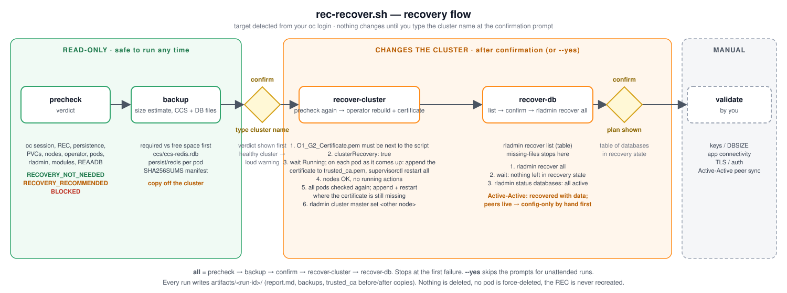

# rec-recover.sh - recover a Redis Enterprise cluster on OpenShift

## What this script does

When a Redis Enterprise cluster on OpenShift loses more than half of its nodes at once, the surviving pods
cannot form a quorum and the cluster stops serving. The data is usually still there: the cluster
configuration (CCS) and every database's persistence files live on the persistent volumes, and those
survive the pods.

`rec-recover.sh` brings such a cluster back in a controlled way:

1. **Checks** that recovery is really needed and that everything it depends on is in place.
2. **Backs up** the cluster configuration and the database files from the pods, so the recovery can never
   make things worse than they already are.
3. **Rebuilds the cluster** by asking the Redis Enterprise operator to recover it. The operator recreates the
   pods on the same volumes, restores the cluster configuration from the CCS and rejoins the nodes.
4. **Recovers every database** from its persistence files, one `rladmin recover db` at a time, handling
   standard and Active-Active databases differently.

Nothing changes on the cluster until you type the cluster name at a confirmation prompt. Database and
application validation afterwards is yours: check keys, TLS, authentication and client connectivity.

```bash
./rec-recover.sh precheck          # read-only: is recovery needed? what would block it?
./rec-recover.sh backup            # archive CCS + database files from the pods
./rec-recover.sh recover-cluster   # operator rebuilds the cluster (asks you to confirm)
./rec-recover.sh recover-db        # recover every database, standard and Active-Active
./rec-recover.sh all               # the four steps above in one go
```

## Recovery flow at a glance



Green is read-only, orange changes the cluster, grey is yours to do by hand. The diamonds are the points
where the script stops and waits for you: the confirmation before the rebuild, the Active-Active question
per database, and the confirmation before the databases are recovered.

## Assumptions

The script only covers the situation it was written for. Check these before relying on it.

| Assumption | Why it matters |
|---|---|
| The cluster was deployed with **persistence enabled** (`spec.persistentSpec.enabled: true`). | Without it there is no CCS and no database files to recover from. The precheck blocks. |
| The **original PVCs still exist** and are `Bound`. | The operator mounts them into the new pods. If the volumes are gone, this is a restore-from-external-backup scenario, which this script does not do. |
| The **operator is running** and is the same version as before. | The operator performs the rebuild. The script never recreates the REC itself. |
| The databases you want back had **persistence** (AOF or snapshot) configured. | A database without persistence is recovered empty, by design. |
| For **Active-Active** databases you know whether the other participating clusters are up. | The script asks; the answer decides whether this instance gets its data back or syncs from the peers. |
| The failure is a **cluster** failure, not a single pod or node. | Single faults heal on their own. The precheck says `RECOVERY_NOT_NEEDED` in that case, and the script warns you before letting you override it. |

## Prerequisites on the workstation

- `bash` 3.2 or later
- `oc`, logged in (`oc login`) with access to the REC namespace, nodes and volumeattachments
- `tar`, `awk`, `sed`, `grep`, `base64` (ship with macOS, Linux and Git for Windows)

No `jq`, no Python. Cluster objects are read with `oc -o jsonpath`; REST output is parsed inside the Redis pod.

| Platform | Works? | Notes |
|---|---|---|
| macOS, Linux | Yes | Nothing to install beyond `oc`. |
| Windows, Git Bash | Yes | Open **Git Bash** (comes with Git for Windows), put `oc.exe` on your PATH. The script disables MSYS path rewriting so pod paths reach `oc exec` unchanged. Keep LF line endings (`.gitattributes` enforces this). |
| Windows, WSL | Yes | Behaves like Linux. |
| Windows PowerShell or cmd | No | The script is bash. Use Git Bash or WSL. |

Run it from an admin workstation or bastion **outside** the cluster, never inside a Redis pod (the rebuild
recreates the pods). Use `tmux` or `screen`: the rebuild can take 10 to 30 minutes.

**The target is detected for you.** Every command first checks the `oc` session and stops with a clear
message if it has expired, then looks for `RedisEnterpriseCluster` resources on the logged-in cluster. One
is used automatically, several give you a numbered prompt, none is an error. Pin a cluster with `NS`/`REC`
in the settings file if you prefer.

## Commands in detail

### `precheck`  (read-only)

Checks the REC state, persistence, PVCs, OpenShift nodes, VolumeAttachments pinned to dead nodes, the
operator, pod readiness, `rladmin status` (under a timeout, so a dead cluster cannot hang the script), loaded
module versions, and the Active-Active inventory. Ends with a verdict:

| Verdict | Meaning | Next |
|---|---|---|
| `RECOVERY_NOT_NEEDED` | Cluster healthy or healing. | Nothing. Re-run in a few minutes if pods are still restarting. |
| `RECOVERY_RECOMMENDED` | Quorum lost or cluster unhealthy. | `backup`, `recover-cluster`, `recover-db`, or simply `all`. |
| `BLOCKED` | A prerequisite is missing. | Fix the FAIL lines, re-run `precheck`. |

### `backup`  (read-only on the cluster)

Prints a **size estimate first**: the CCS directory and each pod's database directory (uncompressed, so an
upper bound) against the free space where the archives will be written. It stops if there is not enough
space, warns above 80 % usage, and tells you which pods exceed `BACKUP_MAX_BYTES` and will be skipped. Then
it archives the CCS from the first reachable pod and the database files from every reachable pod into
`artifacts/<run>/backup/`, with a `SHA256SUMS` manifest. **Copy that folder off the cluster before you
continue.** To write the archives somewhere bigger, set `ARTIFACT_ROOT` in the settings file.

### `recover-cluster`  (changes the cluster)

1. Re-runs the precheck. `BLOCKED` stops here.
2. Shows the verdict and asks you to **type the cluster name**. A `RECOVERY_NOT_NEEDED` verdict adds a loud
   warning first.
3. **Saves files the rebuild is known to overwrite** from the master node's pod, after checking they exist.
   By default that is `/etc/opt/redislabs/trusted_ca.pem`; add more with `PRESERVE_FILES`. (Set
   `PRESERVE_SCOPE=all` to save from every pod instead.)
4. Patches `spec.clusterRecovery: true`. The operator recreates the pods on the existing volumes and restores
   the cluster configuration.
5. Waits until the REC is `Running` and the operator has cleared the flag, then until every pod is Ready.
6. Checks `rladmin status`: every node `OK`, no running cluster actions.
7. **Restores the saved files** on the master node's pod if the content changed or the file disappeared.
   The rebuilt version is kept as `<file>.after-rebuild` under the run's `preserved/` folder, the saved copy
   is written back with its original owner and mode, and `supervisorctl restart all` runs on that node. The
   script then waits for the other pods to carry the same file and reports whether they do. Nothing is
   restarted if the file came through intact.
8. **Moves the cluster master to another node** with `rladmin cluster master set <id>`: the lowest healthy
   node that is not the current master, or `NEW_MASTER_NODE` from the settings file. Turn off with
   `SWITCH_MASTER=false`.

### `recover-db`  (changes the cluster)

1. Runs `rladmin recover list` and classifies every database as standard or Active-Active.
2. Asks one question per Active-Active database (see below).
3. Shows the plan as a table and asks you to type the cluster name.
4. Recovers one database at a time, in this order: data-bearing Active-Active, all standard databases,
   configuration-only Active-Active.
5. Re-runs `rladmin recover list` and expects it to be empty.

Databases reporting `missing-files` stop the command before anything is recovered, with the checks to make.

### `all`

`precheck` → `backup` → `recover-cluster` → `recover-db`, with the same prompts. Stops at the first failure.

## Active-Active databases

An Active-Active database has an instance on each participating cluster. For each one the script asks:

> Are the OTHER participating clusters of this database up and serving right now?

| Answer | Command used | When |
|---|---|---|
| **yes** | `rladmin recover db <name> only_configuration` | Only this cluster failed. The instance comes back empty and syncs from the live peers. |
| **no** | `rladmin recover db <name>` | Every participating cluster was down. This instance is recovered with its data and becomes the source. Do this on **one** cluster only. |

Standard databases always get their data back. `rladmin recover all` is never used, because the two kinds
need different treatment.

## Unattended runs

`--yes` skips every prompt. The confirmation is accepted and Active-Active databases use `AA_MODE`
(default `config-only`) unless named in `AA_DATA_BEARING` or `AA_CONFIG_ONLY` in the settings file.

```bash
./rec-recover.sh all --yes
```

## Settings file

Optional. Copy `rec-recover.env.example` to `rec-recover.env` next to the script. It documents every
setting: pinning a cluster, the files to preserve across the rebuild and where to restore them, the master
switch after recovery, where to write backups, timeouts for very large databases, and the Active-Active
defaults for unattended runs.

## Output

Colour-coded status lines (green PASS, orange WARN, red FAIL), a banner per phase, a verdict box and a
summary footer. Colour turns off when output is not a terminal or with `NO_COLOR=1`. Each run writes
`artifacts/<run>/` with `report.md`, `report.tsv`, `run.log`, raw `rladmin` output, `rec-spec.yaml` (a copy
of the REC for manual recreation), the preserved files, the database plan and the backup archives.

## Safety rules

- Read-only until you confirm; `recover-cluster` and `recover-db` need the cluster name typed, or `--yes`.
- The precheck runs again inside `recover-cluster`; `BLOCKED` refuses to continue.
- Nothing is ever deleted: no PVCs, no VolumeAttachments, no force-deleted pods. The REC is never recreated.
- Every `rladmin` call runs under an in-container timeout.

## Test offline

`../tests/run-offline.sh shell` runs the whole flow against a fake `oc`. It proves control flow and gating,
not real cluster behaviour. `../break_the_cluster.md` describes a full end-to-end test on a disposable cluster.
